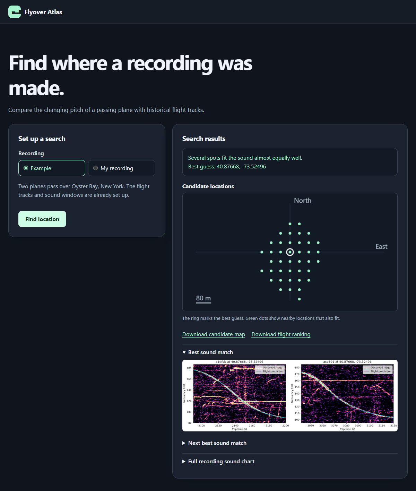

# Flyover Atlas

**Estimate where a recording was made from the sound of passing aircraft.**

Flyover Atlas compares how a plane's pitch changes in an audio or video recording with historical flight tracks. It ranks spots inside a search area, shows how closely the predicted sound matches, and marks when several spots fit about equally well.



[Try the example](#try-the-example) · [Use your own recording](#use-your-own-recording) · [CLI reference](docs/cli.md) · [Benchmark results](benchmarks/results.md)

## Try the example

1. Install [Python](https://www.python.org/downloads/) 3.12 or newer, [uv](https://docs.astral.sh/uv/getting-started/installation/), and [FFmpeg](https://ffmpeg.org/download.html). Make sure `uv`, `ffmpeg`, and `ffprobe` are available from your terminal.
2. Clone this repository and download the public challenge recording. The regional flight tracks and measured flyover windows are included.

   ```powershell
   git clone https://github.com/abhiraj109/flyover-atlas.git
   cd flyover-atlas
   uv sync --locked
   uvx yt-dlp --no-playlist -f "bestaudio[ext=webm]" -o "data/benchmark/challenge.webm" https://youtu.be/4CxVxuMVkMc
   ```

3. On Windows, double-click **Open Flyover Atlas.cmd**. You can also start the browser workspace from the repository with `uv run python -m placefinder.web`.
4. Leave **Example** selected and click **Find location**. Open **Best sound match** to compare the predicted aircraft pitches with the recording.

The browser workspace runs on your computer. The first search in an area can download terrain tiles. Each search writes its files to a new folder under `runs/interface/`.

## Use your own recording

Choose **My recording** and supply the audio or video, a CSV of historical aircraft positions for the date and area, and a search box. Mark each flyover with its start and end in seconds and its low and high pitch in Hz. If you need to find those windows, the CLI can draw a [sound chart](docs/cli.md#prepare-your-own-recording) from your recording first.

| What you know | What to enter |
| --- | --- |
| One usable flyover and the recording start time | Enter the first flyover window and the UTC time of the first audio sample. |
| Two usable flyovers and an unknown start time | Enter both windows in order. The search fits a single recording start time to both flyovers. |

The workspace accepts recordings up to 256 MB and flight CSVs up to 32 MB. See the [track format](docs/cli.md#flight-track-format) for the required columns and units.

## Read the result

| Result | Meaning |
| --- | --- |
| **Candidate** | One spot fits the sound best under the search settings. |
| **Ambiguous** | Multiple spots fit similarly. Use the candidate plot to see how far they spread. |
| **Insufficient evidence** | The available recording and tracks provide too little support to pick a spot. |

The regional Oyster Bay search ranked the expected aircraft pair first. Its best point was **23.6 m** from the published reference, while the nearby matches extended **255 m** from that point. Flyover Atlas reported **ambiguous**. That distance measures agreement with the reference in this benchmark. Results depend on the selected windows, flight coverage, terrain, and search area. [Benchmark report](benchmarks/results.md)

Download the **candidate map** as GeoJSON for QGIS or the **flight ranking** as CSV. The [output reference](docs/cli.md#output-files) describes the files saved alongside them.

## Development and credits

Run `uv run pytest -q` for the automated tests and `uv run python benchmarks/validate.py runs/synthetic` for the reproducible synthetic benchmark. The CLI is available as `uv run flyover-atlas`. Existing scripts can still use the `placefinder` command.

The benchmark uses Colsto's public recording and a regional subset of historical ADS-B positions from ADSB.lol. The search uses flight indexing and geodesy from [dopplertrack](https://github.com/mjshiggins/dopplertrack). Source links and the dataset license are in the [benchmark input notes](data/benchmark/README.md).
